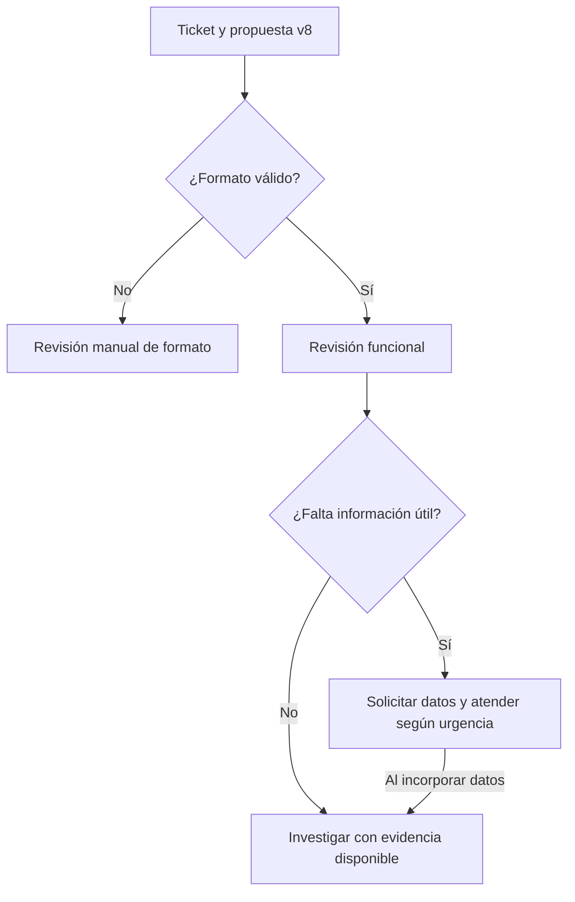

# Etapa 2 — primera lección: orquestación de la atención de tickets

Estado: diseño didáctico inicial, no implementado. Fecha: 15 de octubre de 2026. La etapa 1 permanece cerrada y v8 no se modifica.

## Objetivo de aprendizaje
Distinguir la clasificación de un ticket del flujo que usa esa clasificación. Explicar qué decide la aplicación y qué valida una persona. Aplicarlo a T02.

## Qué significa orquestar (orchestration)
En nuestro diseño, orquestar es coordinar pasos y decisiones: recibir el ticket, pedir una clasificación, comprobar la respuesta y definir el siguiente tratamiento. El modelo propone información; el proceso decide cómo usarla.

Un workflow tiene entrada, pasos, condiciones y salidas. No necesita que cada paso llame a una IA: comprobar claves/tipos es una operación programada; evaluar utilidad y autorizar una derivación puede corresponder a una persona.

## Dos usos del término que debemos separar

| Uso | Qué coordina | Ejemplo |
| --- | --- | --- |
| Orquestación funcional del laboratorio | Etapas de atención y sus decisiones | Revisar propuesta y preparar derivación/pedido de datos |
| SAP Orchestration Service | Configuración y módulos alrededor de llamadas a modelos | Plantilla, modelo y módulos como masking o filtering |

La documentación SAP muestra módulos de templating, LLM, data masking y content filtering. Eso no demuestra que nuestra aplicación ya gestione la cola de soporte. El ejemplo oficial también explica que la aplicación ejecuta las herramientas solicitadas y que la gestión de estado conversacional queda a cargo del código cliente. No asumimos estas capacidades implementadas.

Fuente oficial consultada:
- [SAP Orchestration Service V2 API](https://help.sap.com/doc/generative-ai-hub-sdk/CLOUD/en-US/_reference/orchestration-service2.html).
- [SAP Orchestration](https://help.sap.com/docs/sap-ai-core/generative-ai/orchestration?version=CLOUD).

Esta lección es diseño funcional. Configuración real del servicio, módulos disponibles en el entorno y SDK se revisarán en una práctica posterior; no se deducen de una captura del editor de prompts.

## Flujo inicial propuesto

Reglas del diseño:
- La revisión funcional contrasta categoría, impacto, referencia, resumen y preguntas con el ticket. Pasar formato no equivale a aprobar contenido.
- La condición sobre información faltante se decide con el ticket y la revisión, no únicamente con que datos_faltantes sea [] o no.
- Una lista vacía no significa incidente resuelto.
- Si faltan datos, prepararlos como solicitud de información. No inventarlos.
- Urgencia y completitud son dimensiones distintas: un incidente Alta puede necesitar atención prioritaria y recopilación de datos en paralelo.
- Derivar o pedir información todavía significa preparar una propuesta en esta práctica; no se envían mensajes ni se crean tickets externos.

## Aplicación a T02
La factura FV-1042 no se contabiliza, todo Finanzas está bloqueado y el cierre detenido. v8 propone Finanzas, Alta y pide error exacto/pasos.

La clasificación aporta categoría y prioridad. La orquestación propuesta agrega:
1. Comprobar el JSON.
2. Una persona revisa y confirma el impacto y la propuesta.
3. Preparar atención/derivación prioritaria a Finanzas y el pedido de error/pasos en paralelo.
4. Registrar evidencia y continuar investigación al recibirla.

No marcar T02 resuelto solo porque fue clasificado. Tampoco suspender automáticamente la atención de un bloqueo de equipo hasta reunir todos los datos. Estas son reglas educativas propuestas para el flujo, no una política universal de soporte.

## Contratos separados
v8 conserva seis claves. Un flujo posterior puede tener estado, área sugerida, decisión de revisión y acciones propuestas en un registro separado. No añadir esos campos al JSON de clasificación ni decir que ya fueron ejecutados.

## Ejercicio 1 — respuesta recibida
Gastón indicó que gestionaría la atención y la solicitud de información en paralelo para avanzar. La respuesta coincide con el criterio explicado para T02: bloqueo de equipo con prioridad Alta y recopilación de datos en paralelo.

Esto comprueba ese criterio puntual de la lección. No equivale a aprobar todas las respuestas del modelo ni a validar todas las observaciones cualitativas de la etapa 1.

## Segunda lección: prioridad y estados (priority / status)
La prioridad expresa urgencia relativa según nuestra política. El estado expresa en qué situación está el trabajo. Tener datos pendientes no obliga a bajar la prioridad ni a dejar toda la atención detenida.

Propuesta educativa de metadatos separados para simular T02, después de validar la propuesta:

| Dato | Valor propuesto | Significado |
| --- | --- | --- |
| prioridad | Alta | El proceso está detenido para todo el equipo |
| estado_atencion | En atención | Se organiza la respuesta al bloqueo |
| estado_informacion | Pendiente | Se recopilan error exacto y pasos |

Estos valores son un ejemplo simulado, no un ticket real actualizado. Prioridad ya existe en la clasificación; los dos estados pertenecen al flujo propuesto y no se agregan al JSON de seis claves de v8.

“Pendiente de información” describe una necesidad de investigación, no demuestra resolución ni determina por sí solo la urgencia. Si una herramienta falla al consultar datos, eso tampoco prueba que el incidente ERP esté resuelto.

## Ejercicio 2 — pendiente de respuesta
T06 solicita un reporte mensual de ventas por cliente y no hay interrupción del negocio. Falta acordar campos y filtros. ¿Qué prioridad le corresponde? ¿Lo tratarías como atención de un bloqueo urgente o como definición de una solicitud planificada?

El 17 de octubre se añadió una [práctica guiada con T02 y T06](STAGE_2_PRACTICE_02.md): reglas de decisión, eventos y transiciones iniciales. La respuesta a este ejercicio no se recibió; la guía explica T06 sin atribuir esa respuesta a Gastón. El ejercicio 3 recibió respuesta: Gastón eligió cambiar el estado de la información. Se aclaró que permite investigar sin implicar corrección ejecutada; el detalle está en la práctica. Todavía no hay simulación con código ni acciones externas.
