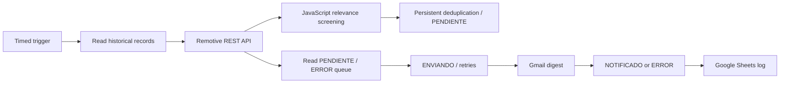

# Opportunity Radar Automation — n8n Workflow Case Study

**Portfolio case study • October 2026**  
**Technologies:** n8n · REST API · JavaScript · Google Sheets · Gmail · Persistent queue design

## What I built
A remote-opportunity monitoring workflow that turns an external job feed into a structured notification pipeline: read prior records, classify titles and geography, avoid duplicates, persist notification states and prepare a concise email digest.

The business objective is to reduce repetitive manual monitoring while keeping an auditable record of notifications and failures.

## How it works
- A scheduled n8n workflow uses a remote job listing API and JavaScript matching rules to shortlist roles relevant to ERP, business analysis, support, automation, AI and development.
- It checks an existing Sheets history and n8n Data Table to avoid notifying the same listing repeatedly.
- A separate queue path handles unfinished notifications, capped at three attempts; states include `PENDIENTE`, `ENVIANDO`, `NOTIFICADO`, `ERROR`, and `AGOTADO`.
- Instead of contacting employers, it prepares an email digest to the account owner with job links and proposal starters requiring review.

## Evidence and current status
- The latest pilot workflow was published in n8n on **30 October 2026**.
- A 22-node import ran successfully in a no-new-real-notification scenario. The expected exclusion of a synthetic `test:` record was observed.
- An **isolated** three-node Gmail test executed successfully, with actual receipt of the email confirmed.
- The first real digest's full status transition and Sheets logging have **not** yet been independently verified. No job proposals were automatically sent.

## Engineering practices
**Problem framing · Business rules · API integration · JSON transformations · Deduplication · Reliability design · Error handling · Documented limitations.**

## Scope and privacy
This page is a **sanitized public case study**, not the original importable workflow. The working repository is private because it references specific accounts, credential identifiers and Google Sheets documents. No secrets or private configuration are included here.

This project is separate from ERP Ticket Lab and is linked here to provide a single public portfolio hub.

## Related repositories
- [ERP Ticket Lab — AI applied to support](https://github.com/gastonferreira125-rgb/erp-ticket-lab)
- [Dynamics 365 Consultant & Developer Lab](https://github.com/gastonferreira125-rgb/dynamics-365-consultor-developer-lab)
- [Travel Agency ASP.NET MVC Application](https://github.com/gastonferreira125-rgb/agencia-viajes-aspnet-mvc)
