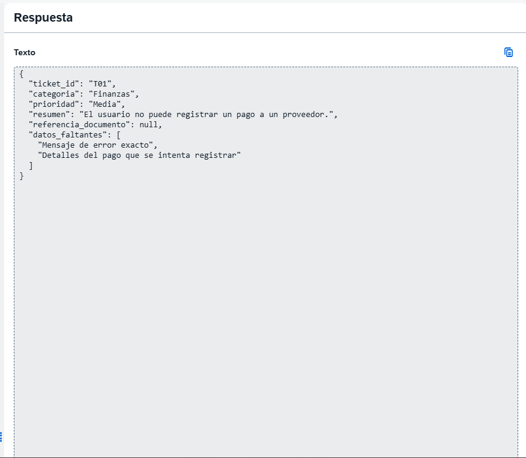
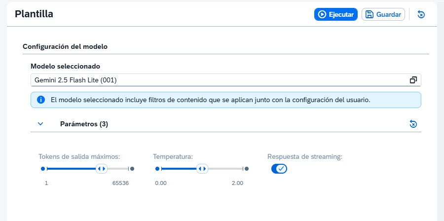
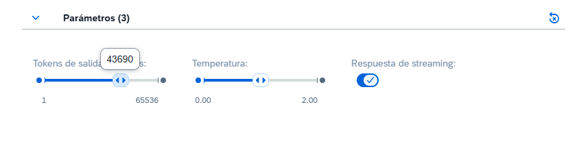
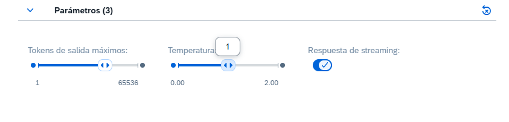

# Primera ejecución: T01

Fecha: 13 de octubre de 2026 (America/Montevideo). Hora exacta de ejecución no registrada.

## Entorno y trazabilidad
- SAP AI Launchpad, sistema de práctica compartido identificado en la captura previa.
- Modelo confirmado en la captura de configuración posterior a T01: Gemini 2.5 Flash Lite (001).
- La versión API y el identificador técnico del modelo no se han confirmado.
- Bloque de mensaje: Usuario, según las instrucciones y la captura previa.
- Prompt: v0-baseline; [texto indicado para esta ejecución](prompt.txt).
- La captura del resultado no incluye el prompt. Una segunda captura muestra el selector de modelo y los parámetros expandidos.
- Parámetros actuales confirmados mediante etiquetas en capturas posteriores a T01: temperatura 1; tokens de salida máximos 43690; streaming activado. Son valores observados después de la ejecución, siguiendo la instrucción de no mover los controles. No se confundieron los extremos de los rangos con los valores seleccionados.
- Entrada: únicamente id y texto del ticket T01; las etiquetas esperadas no forman parte del prompt.
- Ejecución manual por Gastón; respuesta copiada al chat y contrastada con la captura.

## Evidencia
- [Respuesta original](response-original.json): contenido sin correcciones.
- [Evaluación automática del conjunto](evaluation.json).
- Captura aportada por el usuario, limitada al panel de respuesta:

Captura posterior de configuración:

Valores exactos visibles en las etiquetas:

- [Configuración actual registrada](configuration-observed.json)

## Resultado automático
El evaluador del repositorio se ejecutó sobre responses.json:
- Cobertura: 1 de 10 tickets; los otros nueve siguen sin ejecutar.
- T01: cumple las comprobaciones de campos y tipos del evaluador.
- Etiquetas de referencia: coinciden los cuatro campos evaluados (ticket_id, categoria, prioridad y referencia_documento).
- Referencias inventadas detectadas por el evaluador: 0.
- Sin identificadores duplicados ni desconocidos.

No se interpreta la ausencia de T02–T10 como una respuesta errónea de un modelo. Este único caso no permite concluir calidad general ni comparar modelos.

## Revisión humana
- Finanzas: coherente con el proceso de pago a proveedores.
- Media: coherente con la regla del laboratorio; el texto no afirma que todo un equipo esté detenido.
- Resumen: fiel al incidente, sin causa ni solución inventada.
- referencia_documento: null, porque no se suministró un identificador de documento.
- Datos faltantes: el mensaje de error exacto es útil. “Detalles del pago” es pertinente, pero amplio: podrían precisarse pasos de reproducción, alcance del impacto y contexto del pago.
- Se conserva la salida original; la observación se usa para una futura versión del prompt, no para corregir el resultado.

## Aprendizaje y próximo paso
Conceptos explicados: prompt, JSON, clasificación frente a diagnóstico, prioridad según impacto explícito y null.
Comprobación de aprendizaje: Gastón respondió correctamente que prioridad Alta requiere que el texto afirme que un proceso está detenido para todo un equipo. Esta comprobación cubre la regla de prioridad; los demás conceptos seguirán revisándose con ejercicios.
Siguiente acción: ejecutar T02 manteniendo modelo, reglas y parámetros actuales. Cambiar únicamente el identificador y el texto de entrada.
