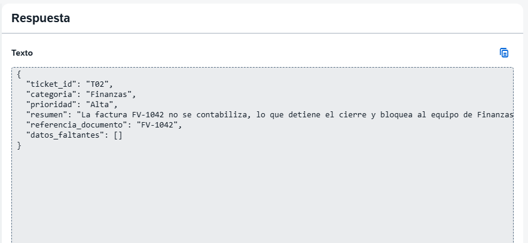

# Segunda ejecución: T02

Fecha: 13 de octubre de 2026 (America/Montevideo). Hora exacta de ejecución no registrada.

## Entrada y configuración indicada
ticket_id: T02

La factura FV-1042 no se contabiliza. Todo el equipo de Finanzas está bloqueado y el cierre está detenido.

Se indicó mantener v0-baseline y cambiar únicamente id y texto. Modelo y parámetros de referencia: Gemini 2.5 Flash Lite (001), temperatura 1, tokens de salida máximos 43690 y streaming activado, según la configuración documentada después de T01. La captura de T02 muestra únicamente la respuesta, no confirma de nuevo el prompt ni los parámetros.

## Evidencia
- [Salida original completa](response-original.json), copiada por Gastón desde SAP después de aportar la captura. Sin correcciones.
- [Prompt indicado](prompt.txt), con las mismas reglas de v0 y la entrada T02.
- [Evaluación automática del conjunto](evaluation.json).

La captura inicial no mostraba el final del resumen. El texto original completo se obtuvo posteriormente y permite conservar y evaluar la salida sin reconstruirla.

## Resultado automático
El evaluador del repositorio se ejecutó sobre responses.json:
- Cobertura: 2 de 10 tickets.
- T01 y T02 cumplen las comprobaciones de campos y tipos del evaluador.
- Los dos coinciden con sus etiquetas de referencia.
- Referencias inventadas detectadas: 0; sin IDs duplicados ni desconocidos.
- Los ocho casos restantes todavía no se ejecutaron.
- No hay mediciones de calidad general, tiempos ni comparación de modelos.

## Revisión humana
| Campo | Resultado | Evaluación |
| --- | --- | --- |
| ticket_id | T02 | Coincide con la entrada. |
| categoria | Finanzas | Coherente con el incidente. |
| prioridad | Alta | Todo el equipo está bloqueado y el cierre detenido. |
| resumen | Factura no contabilizada, cierre detenido y equipo bloqueado. | Fiel al incidente; no inventa diagnóstico ni solución. |
| referencia_documento | FV-1042 | Copia la referencia explícita. |
| datos_faltantes | [] | Insuficiente para ayudar a investigar este incidente. |

El incidente identifica el documento y el impacto, pero no proporciona el error exacto, los pasos para reproducir ni las verificaciones realizadas. Un array vacío está permitido por schema.json y el evaluador, pero eso no demuestra que el contenido sea suficiente para soporte.

Posible mejora futura: pedir información concreta para investigar cuando no esté en el ticket, aunque categoría, prioridad y referencia estén claras. Se mantiene v0 sin cambios para no mezclar condiciones.

## Aprendizaje y próximo paso
Gastón preguntó por los roles Sistema y Asistente. Se explica la diferencia entre instrucciones generales (Sistema), entrada del caso (Usuario) y respuestas previas o ejemplos (Asistente). La primera versión usa un único mensaje Usuario como referencia inicial.

Primero ejecutar T10 con v0. Luego crear una versión de roles separados con las mismas reglas y comparar, manteniendo los parámetros. La mejora de datos faltantes se probará por separado; no se atribuye el hallazgo de T02 a haber usado el bloque Usuario sin evidencia.
