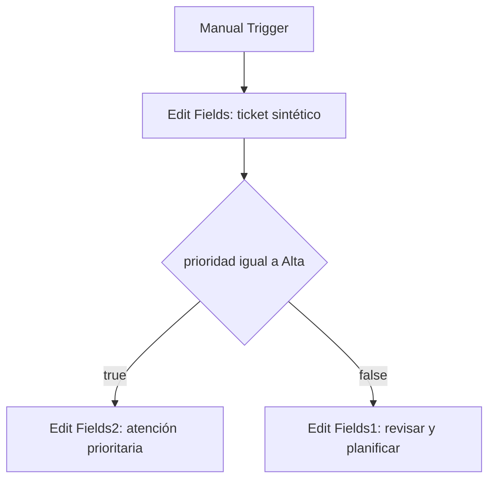

# n8n Ticket Routing — Lab 01

Educational workflow built manually in n8n Cloud on 28 October 2026. Synthetic ERP tickets, manually assigned classifications and deterministic routing. No live ERP or model connection.

## Resultado observado
Se construyó un flujo con Manual Trigger, Edit Fields, If y dos nodos Edit Fields de salida.
- T06 / Baja: se observó el recorrido false hasta Edit Fields1 tras corregir la conexión.
- T02 / Alta: se observó el recorrido true hasta Edit Fields2 y una salida con los cuatro campos de entrada más siguiente_accion.
- Se conservaron siete capturas seleccionadas de ejecución y correcciones. Son evidencia visual; el JSON exportado del workflow ya fue recibido y archivado (véase sección de exportación).

## Arquitectura

La prioridad viene de la entrada. El If no clasifica el texto, no determina el impacto y no utiliza IA. Edit Fields agrega una propuesta fija; no envía una solicitud ni ejecuta atención en paralelo.

## Datos y reglas

El nodo de entrada define cuatro campos String: ticket_id, categoria, prioridad y resumen.
Es un contrato reducido para aprender n8n, no el contrato de seis claves del clasificador v8. No se modificaron v8, sus respuestas o métricas.

| Caso | Categoría | Prioridad cargada | Resumen sintético |
|---|---|---|---|
| T06 | Reportes | Baja | Solicitud de reporte mensual de ventas por cliente. Faltan campos y filtros. |
| T02 | Finanzas | Alta | La factura FV-1042 no se contabiliza. Todo Finanzas está bloqueado y el cierre detenido. Faltan el error exacto y los pasos realizados. |

If:
- Valor izquierdo en modo expresión: `{{ $json.prioridad }}`.
- Operador String: is equal to.
- Valor derecho fijo: Alta.

`$json` representa los datos del item actual; `.prioridad` selecciona ese campo.
False significa “la condición no se cumple”, no error ni necesariamente prioridad Baja. Media también saldría por false. Esta respuesta se comprobó conceptualmente en tutoría; no se recibió una ejecución específica de Media.

| Salida | Nodo | siguiente_accion, tipo String |
|---|---|---|
| true | Edit Fields2 | Proponer atención prioritaria y solicitar datos faltantes en paralelo |
| false | Edit Fields1 | Revisar requisitos e impacto para planificar atención |

En ambos nodos de salida: Include Other Input Fields activado; Input Fields to Include = All.
Así se mantienen los cuatro campos y se agrega un quinto.

## Reproducción manual
1. Crear un workflow y nombrarlo ERP Ticket Lab - Flujo 01.
2. Agregar Manual Trigger (When clicking Execute workflow).
3. Conectarlo a Edit Fields; usar Manual Mapping y cargar los cuatro campos de uno de los casos.
4. Conectar Edit Fields a If y configurar la comparación descrita.
5. Desde true conectar Edit Fields2; desde false conectar Edit Fields1. No conectar la salida directamente desde el nodo de entrada.
6. Configurar cada siguiente_accion y conservar todos los campos de entrada.
7. Con T06/Baja, ejecutar el workflow completo y verificar false y salida enriquecida.
8. Sustituir la entrada por T02/Alta, ejecutar el workflow completo y verificar true y los cinco campos.
9. Revisar datos de la ejecución actual; editar la configuración no actualiza por sí solo el OUTPUT anterior.

No requiere publicar el workflow, conectar correo, credenciales de modelos ni SAP. El entorno observado fue n8n Cloud en prueba temporal; no se presume acceso gratuito permanente.

## Evidencia y pruebas
[Índice de capturas](evidence/2026-10-28/README.md).

| Comprobación | Resultado y alcance |
|---|---|
| T06 / Baja comparada con Alta | False observado con expresión corregida |
| Valor Alta temporal sobre T06 | True observado como prueba de condición; no es reclasificación funcional de T06 |
| T06 / salida enriquecida | Cinco campos observados; esa captura es anterior a corregir el cableado |
| T06 / cableado corregido | Lienzo muestra false → Edit Fields1, un item y ejecución correcta; falta captura del OUTPUT posterior a esa corrección |
| T02 / Alta con ambas ramas conectadas | Un item por true; rama false sin recorrido en esa ejecución |
| T02 / salida final | Cinco campos observados; siguiente_accion coincide con la propuesta prioritaria |
| Media | Resultado false explicado correctamente; prueba ejecutada pendiente |

Las capturas reflejan momentos distintos, no una ejecución única. No se calculan porcentajes de calidad ni ahorro a partir de estas pruebas.

## Correcciones registradas
1. If usaba ticket_id en vez de prioridad. T06 != Alta daba false por el motivo incorrecto. Se corrigió la expresión y se probaron ambos valores de condición.
2. Include Other Input Fields estaba apagado. La salida contenía solo siguiente_accion. Al activarlo aparecieron los cinco campos.
3. Edit Fields1 estaba conectado directamente a Edit Fields. Se quitó esa conexión y se enlazó false → Edit Fields1.
4. El OUTPUT seguía mostrando datos anteriores tras editar la entrada. Se volvió a ejecutar para obtener datos actuales.
5. “Node was not executed” en una rama sin items no demuestra fallo: hay que revisar por qué camino fue la ejecución.

Se documentan comportamientos y correcciones técnicas, sin atribuir valoraciones personales al participante.

## Límites y próximos pasos
- Estado: laboratorio de routing ejecutado con evidencia en ambas ramas; exportación e inspección del workflow JSON completadas.
- Las capturas prueban lo visible, no persistencia, versión exacta de n8n o reproducibilidad automática.
- El último caso mostrado es T02/Alta.
- El JSON exportado real se recibió y archivó tras retirar el identificador de instancia. La captura del OUTPUT final de T06 posterior al cableado corregido sigue pendiente; no se considera requisito para avanzar a la siguiente lección.
- Añadir validación de valores permitidos antes del routing: hoy un valor vacío/desconocido puede ir por false y parecer un caso no alto.
- Faltan validación humana formal, gestión de estados, persistencia, errores de integración y datos faltantes estructurados.
- No hay nueva inferencia, agente, MCP, RAG ni conexión SAP/Dynamics. “En paralelo” es texto de una recomendación; no dos tareas implementadas.
- No se creó ni resolvió un ticket empresarial real.

## Interview practice
**What does your n8n workflow do?**

“It routes synthetic ERP tickets using a manually supplied priority. An If node checks whether the priority is High, and a Set node adds a proposed next action while preserving the original fields. I tested both branches and corrected a field mapping and a connection issue. This version does not call an AI model or connect to a live ERP.”

## Registro de continuidad
Fecha: 28/10/2026.
Evidencia revisada: capturas aportadas por el participante; nombres originales y correspondencia en el índice.
Próxima acción: exportar el workflow real, verificar contenido y cerrar el paquete reproducible antes de añadir nuevas integraciones.

## Archivo exportado y reproducibilidad — 28/10/2026

- Se recibió el export real de n8n en formato JSON y se conservó una copia: [workflow.json](workflow.json).
- Se validó la sintaxis JSON y la topología de cinco nodos: Manual Trigger → Edit Fields → If; true → Edit Fields2; false → Edit Fields1.
- La condición almacenada es `={{ $json.prioridad }}` igual a `Alta`; los nodos de salida preservan los demás campos (`includeOtherFields: true`).
- El export contiene como entrada el caso T02 / Finanzas / Alta. Los datos de T06 no permanecieron en el export; sus pruebas previas están registradas por capturas.
- No se detectaron nodos con `credentials`. Para evitar publicar identificadores de la instancia se eliminó únicamente `meta.instanceId` del archivo versionado; el archivo original permanece en la conversación del participante.
- `active: false` en el export; no hay pruebas de ejecución desde este JSON importado en otra instancia.
- El JSON refleja la configuración de nodos y conexiones, **no** incluye historial de ejecuciones, credenciales ni prueba de integración con un ERP real.
- El siguiente desarrollo será validar que `prioridad` pertenezca a los valores `Alta`, `Media` o `Baja`; un valor inválido no debe enrutarse como caso normal por `false`.

## Validación de prioridades — avance 28/10/2026

Evidencia: dos capturas recibidas en el chat de estudio (aún no publicadas como archivos en el repositorio). Se observa el nuevo nodo `Validar prioridad` (If) entre `Edit Fields` y el `If` original.

- Expresión configurada: `{{ ['Alta', 'Media', 'Baja'].includes($json.prioridad) }}`; operador Boolean `is true`.
- Prueba observada: entrada T02 / Finanzas / Alta, un item en la rama true del validador y continuación al If original y Edit Fields2.
- Resultado: validación de caso permitido conforme. Las capturas no prueban todavía el comportamiento de `Media`, valores vacíos ni inválidos.
- **Pendiente:** conectar false del validador a un nuevo nodo `Edit Fields` para registrar `estado_validacion = Rechazada` y `motivo_validacion`, conservando los campos originales. Ejecutar prueba de `Urgente` para comprobar que no entra al circuito ordinario. No confundir false del validador con false del If original.
- **Enseñanza:** separación Input Validation (dominio permitido) de Business Logic (ruta Alta frente a no Alta). `includes` evalúa pertenencia exacta en un array y devuelve Boolean.

## Prueba negativa — `Urgente` rechazada (28/10/2026)

- Evidencia recibida en tres capturas del chat (archivos todavía no incorporados al repositorio): primer `Edit Fields` con `ticket_id=T02`, `categoria=Finanzas` y `prioridad=Urgente`; configuración de `Revisar prioridad`; y vista del flujo ejecutado.
- El nodo `Revisar prioridad` es un `Edit Fields` añadido a la salida **false** de `Validar prioridad`. Se configuraron dos campos String: `estado_validacion = Rechazada` y `motivo_validacion = Prioridad fuera del catálogo permitido`. `Include Other Input Fields` está habilitado.
- La captura del lienzo muestra recorrido verde `Edit Fields → Validar prioridad (false) → Revisar prioridad`, **1 item** y el nodo final con ejecución correcta. El `If` de negocio no se recorrió en esa ejecución: prueba de enrutamiento negativo confirmada.
- **Evidencia pendiente:** la primera captura del panel `Revisar prioridad` muestra `No output data` / `No fields - node executed, but no items were sent on this branch`, aunque la captura posterior del lienzo muestra la ruta de rechazo con 1 item. Pueden representar ejecuciones distintas; no atribuir ese panel a la última corrida. Reabrir nodo y capturar el JSON de OUTPUT de la última ejecución para validar que conserva cuatro campos y añade los dos campos de rechazo.
- **Pendiente siguiente:** comprobar el OUTPUT de la rama de rechazo y luego probar `Media` y valor vacío. Exportar una **nueva versión** del JSON tras completar la validación; el `workflow.json` del repositorio sigue representando la versión anterior de cinco nodos.

### Aclaración de orden de ejecuciones

- **Aclaración posterior del participante:** el panel `No output data` era de una ejecución anterior, realizada antes de cambiar la prioridad a `Urgente`. Después cambió el dato y ejecutó el workflow, mostrando 1 item en la rama false de validación hacia `Revisar prioridad`. No se observó un fallo de ejecución; sigue sin recibirse una captura JSON del contenido de los campos de salida.
