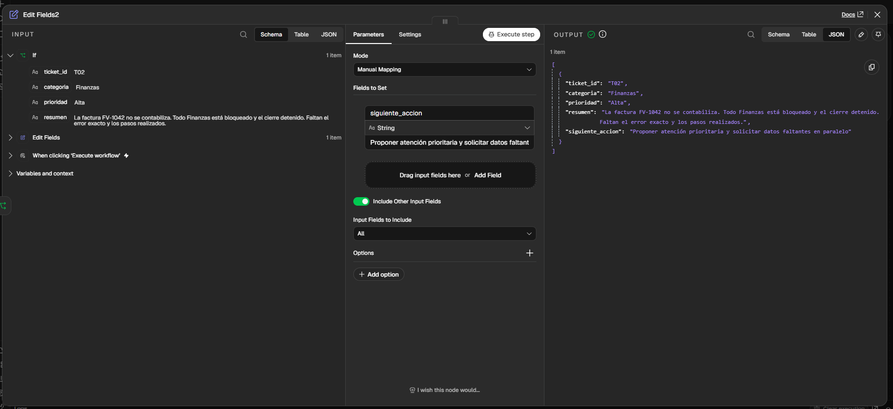
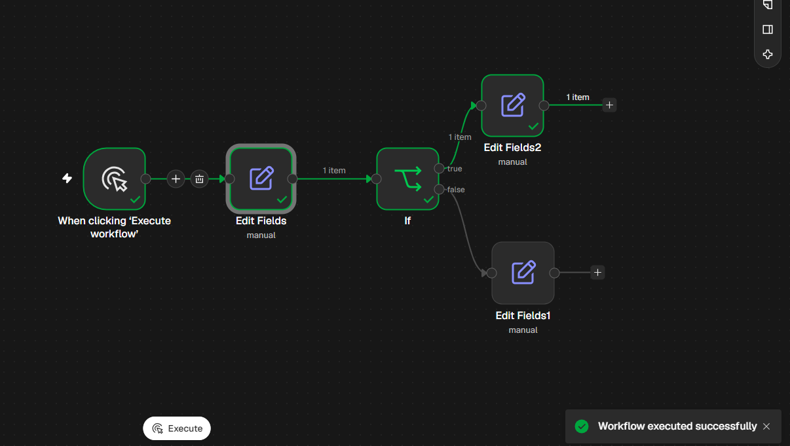
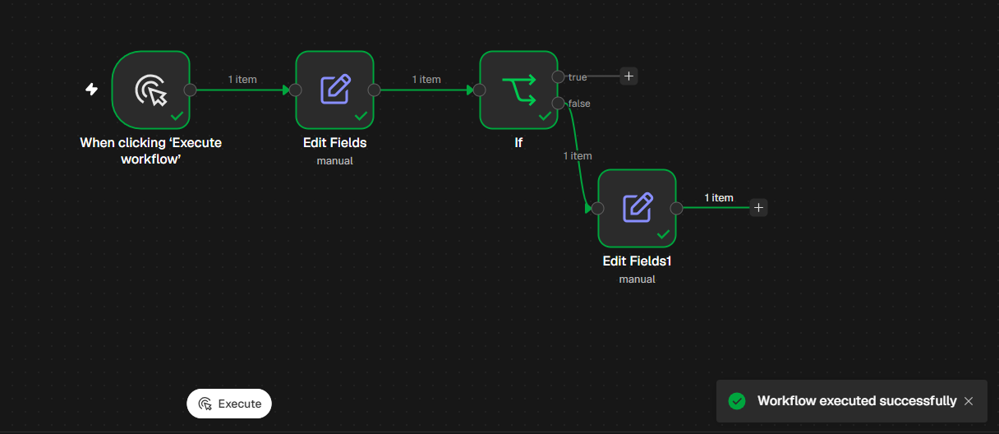

# Evidencia visual — 28/10/2026

Capturas originales aportadas por el participante y revisadas visualmente. Selección representativa de siete imágenes; no es la totalidad de las capturas de la sesión. Sin edición de imagen. Se seleccionaron vistas de nodos/lienzo sin credenciales ni información de una empresa real.

| Archivo | Captura original | Qué permite observar |
|---|---|---|
| [01-condition-wrong-field.png](01-condition-wrong-field.png) | image(20261028-132609).png | Expresión equivocada ticket_id, comparación con Alta y salida false. |
| [02-input-fields-excluded.png](02-input-fields-excluded.png) | image(20261028-133903).png | Include Other Input Fields apagado; salida de un solo campo. |
| [03-connection-bypasses-if.png](03-connection-bypasses-if.png) | image(20261028-134412).png | Conexión directa de entrada al nodo de acción que evita If. |
| [04-t06-enriched-output.png](04-t06-enriched-output.png) | image(20261028-134019).png | Cinco campos de T06 con conservación de entrada activada; anterior a corregir el cableado. |
| [05-false-path-corrected.png](05-false-path-corrected.png) | image(20261028-134605).png | False conectado a Edit Fields1; un item y ejecución correcta. |
| [06-t02-true-path.png](06-t02-true-path.png) | image(20261028-135204).png | Recorrido true a Edit Fields2, un item y ejecución correcta. |
| [07-t02-enriched-output.png](07-t02-enriched-output.png) | image(20261028-135222).png | T02/Alta, entrada desde If y salida con cinco campos y propuesta prioritaria. |

Las horas de los nombres originales se conservan como identificadores, sin inferir zona horaria. Las imágenes no demuestran que un cambio de configuración haya quedado guardado permanentemente ni sustituyen el JSON exportado.

## Resultado final T02

## Recorrido true

## Corrección de rama false

