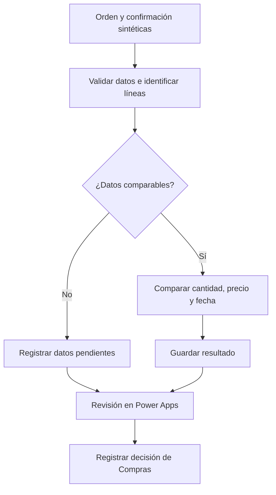

# Control de confirmaciones de proveedores

Caso de aprendizaje y portafolio de Gastón Ferreira. Inicio: 19 de octubre de 2026.

**Estado:** diseño inicial, datos sintéticos y primera lección preparados. No hay aplicación Power Apps, tablas Dataverse, flujo Power Automate o workflow n8n desplegados. No hay integración con SAP o Dynamics ni resultados de ahorro medidos.

## Problema de negocio

Comparar una orden de compra con la confirmación del proveedor para identificar cambios de cantidad, precio o entrega y facilitar su revisión por Compras.

El caso se inspira en una necesidad documentada públicamente por SAP en Lemvigh-Müller: revisión de confirmaciones PDF frente a compras. Es una referencia del problema, no un cliente de este proyecto ni una validación de nuestra implementación. Fuente: [SAP News, 26 de junio de 2026](https://news.sap.com/2026/06/lemvigh-muller-ai-agents-order-confirmations/).

Microsoft publica una [arquitectura de referencia de cotejo de confirmaciones con SAP](https://learn.microsoft.com/en-us/power-platform/architecture/reference-architectures/order-acknowledgment-validation). Nuestra propuesta es una versión educativa acotada, con reglas explícitas y datos ficticios. No replica su infraestructura ni atribuye sus resultados al laboratorio.

## Aprendizaje progresivo

1. Comprender el proceso y comparar dos registros manualmente.
2. Verificar acceso y condiciones del entorno Microsoft.
3. Modelar las tablas de orden, confirmación, diferencias y revisión.
4. Construir una pantalla y una regla de comparación simples.
5. Ejecutar un flujo y conservar su evidencia, incluidos errores.
6. Ampliar a documentos PDF y extracción de datos, si el acceso y el coste lo permiten.
7. Evaluar una integración externa con n8n cuando aporte una función concreta.

No se marcan pasos como completados por haber generado la documentación.

## Responsabilidades de la solución propuesta

| Componente | Responsabilidad en este caso | Estado |
| --- | --- | --- |
| Power Apps | Pantalla para consultar diferencias y registrar la decisión de Compras | Propuesto |
| Dataverse | Tablas para documentos, líneas, discrepancias y revisiones | Propuesto; acceso pendiente |
| Power Automate | Flujo que compara datos y registra el resultado | Propuesto |
| Power BI | Indicadores de diferencias y tiempos observados | Ampliación posterior |
| n8n | Alternativa o integración futura para recepción de documentos externos | No necesario para la primera versión |
| IA generativa | Posible extracción de información no estructurada | Fuera de la primera práctica |
| SAP o Dynamics 365 | ERP de origen o destino en una integración futura | Se representa con datos sintéticos |

Power Platform es una familia de herramientas, no una aplicación única. Power Apps representa la interacción del usuario; Power Automate coordina acciones; Dataverse gestiona los datos. n8n y Power Automate no deben duplicar la misma responsabilidad sin una razón documentada.

## Flujo propuesto

El diagrama es diseño. No demuestra que estos componentes estén conectados.

## Primera práctica

Abrir [Lección 1](LESSON_01.md), observar [los dos registros CSV](data/lesson-01.csv) y responder las preguntas en el chat. No hace falta ejecutar Python ni instalar herramientas para esta práctica.

El [registro de aprendizaje](LEARNING_LOG.md) distingue material preparado, respuestas del estudiante y evidencia de ejecución.

## Contrato inicial de datos

Los dos registros usan el mismo esquema para facilitar la comparación inicial. Es un formato didáctico de intercambio; no implica que deban almacenarse en una sola tabla de Dataverse.

| Campo | Significado |
| --- | --- |
| document_type | PURCHASE_ORDER o SUPPLIER_CONFIRMATION |
| document_id | Identificador del documento |
| po_number | Orden de compra a la que corresponde |
| vendor_code | Proveedor ficticio |
| line_number | Línea de la orden |
| item_code | Artículo ficticio |
| quantity | Cantidad pedida o confirmada |
| uom | Unidad de medida |
| unit_price | Precio unitario, sin impuestos |
| currency | Moneda del precio |
| delivery_date | Fecha pedida o confirmada, ISO YYYY-MM-DD |

El CSV está codificado en UTF-8, separado por comas y usa punto decimal. Si Excel no divide columnas, usar importar desde texto/CSV y elegir coma. No se necesita modificar el equipo para responder la primera práctica.

## Reglas propuestas para el primer prototipo

- Relacionar por orden, proveedor y línea; verificar también artículo.
- Comparar cantidad solo si la unidad de medida coincide.
- Comparar precio solo si moneda y base de precio son compatibles.
- Toda diferencia se envía a revisión en esta primera versión; no hay tolerancias implícitas.
- Una confirmación parcial no demuestra por sí sola cancelación del saldo. Registrar la diferencia y pedir explicación cuando corresponda.
- Guardar la confirmación recibida sin sobrescribir la orden original.
- Distinguir: resultado de comparación, estado de revisión y decisión comercial.
- Coincidencia no significa aprobación contractual ni cambio autorizado en el ERP.
- Datos faltantes o documentos sin relación se registran como no comparables; no inventar datos.
- Distinguir duplicado de documento de una nueva versión de confirmación antes de decidir el tratamiento.

Estas son reglas de alcance del prototipo. Una implementación real requerirá validación con la empresa.

## Evidencia y evaluación posteriores

Se preparará un conjunto de diez casos sintéticos, con criterios esperados definidos antes de ejecutar el flujo. Incluirá coincidencia, cantidad diferente, precio diferente, retraso, combinación de diferencias, datos faltantes, moneda o unidad incompatible, orden desconocida y reenvío de documento.

Registrar detección de diferencias, falsas alarmas y errores de procesamiento. Medir tiempos solo con ejecuciones observadas. No hay métricas obtenidas en este inicio.

Los próximos entregables exportables serán una solución Power Platform, definiciones de flujo y, si se utiliza, un workflow n8n sin credenciales. Todavía no existen esas exportaciones.

## Acceso y coste

La documentación de Microsoft consultada el 19 de octubre de 2026 indica que el Developer Plan requiere cuenta laboral o educativa respaldada por Microsoft Entra ID. No basta una cuenta personal de Gmail.

La misma página anuncia cambios de los entornos de desarrollo no administrados: nuevas restricciones desde el 15 de noviembre de 2026, suspensión desde el 15 de diciembre y eliminación desde el 15 de enero de 2027. Los derechos para entornos administrados no están incluidos en el Developer Plan. AI Builder tampoco está incluido.

Antes de crear recursos, comprobar cuenta, entorno, permisos y licencias actuales. No se promete un entorno gratuito permanente, ni se activan pruebas de pago o servicios de IA como parte de esta documentación. Un bloqueo de acceso no equivale a un fallo del estudiante.

Fuente: [Power Apps Developer Plan](https://learn.microsoft.com/en-us/power-platform/developer/plan). Conservar definiciones y datos exportables, y revisar las condiciones al comenzar la práctica en la plataforma.

## Presentación profesional

Descripción factual actual: diseño de un caso de automatización de compras, asignación de responsabilidades de Power Platform y primera práctica con datos sintéticos.

Solo se añadirá implementación, integración, resultados o dominio de herramientas cuando exista evidencia. El material inicial se preparó con tutoría asistida por IA; las respuestas y decisiones del estudiante se registrarán como tales.

## English overview

Educational procurement confirmation matching case with synthetic records and an initial Power Platform design. Power Apps is proposed for review, Dataverse for records and Power Automate for orchestration. n8n intake and AI document extraction are later extensions. No deployed flows, ERP connections or measured business outcomes exist at kickoff.
